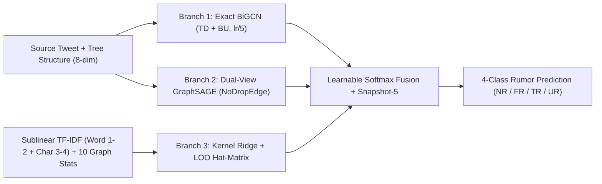
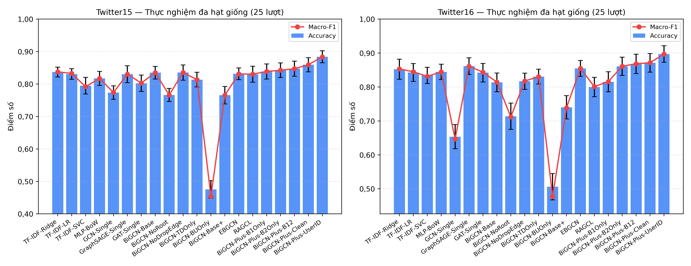
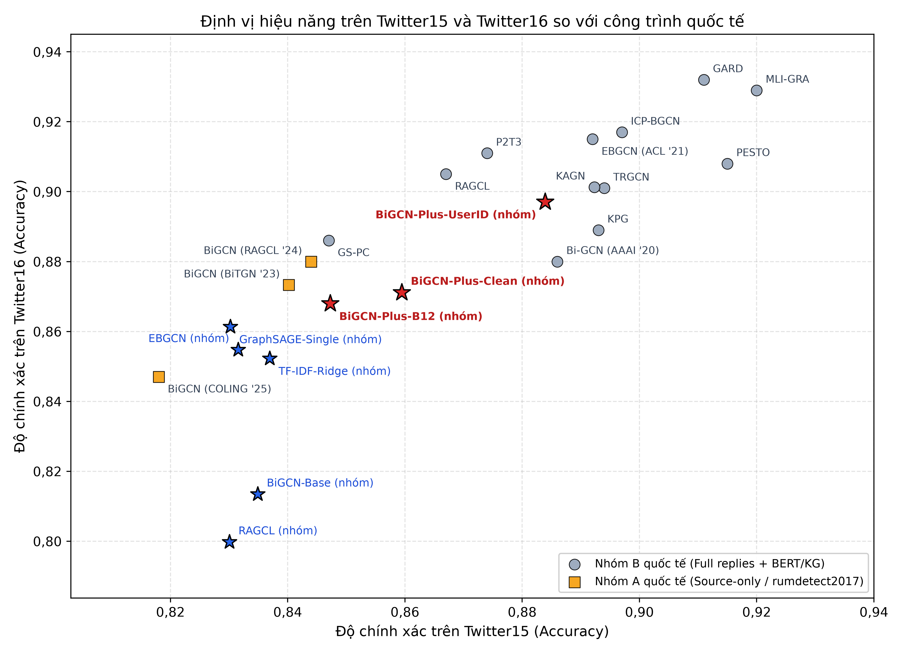

<div align="center">

# BiGCN-Plus: Multi-Seed Rumor Detection Benchmark

**Phát hiện tin đồn trên mạng xã hội dựa trên đồ thị lan truyền hai chiều (`Twitter15` & `Twitter16`)**

[](https://www.python.org/)
[](https://pytorch.org/)
[](https://colab.research.google.com/github/pqui-345/BiGCN-Plus-Rumor-Detection/blob/main/scripts/CT255_RumorDetection_BiGCN_Plus_MultiSeed_5x5_Colab_T4GPU.ipynb)
[-2EA44F?style=for-the-badge)](#3-kết-quả-thực-nghiệm-chuẩn-hóa-25-lượt-chạy-trên-t4-gpu)
[](LICENSE)

</div>

---

## 1. Giới thiệu tổng quan

Kho mã nguồn này là bộ khung thực nghiệm chuẩn hóa cho đề tài **Phát hiện tin đồn trên mạng xã hội dựa trên đồ thị lan truyền hai chiều (`BiGCN` & `BiGCN-Plus`)**, đánh giá trên hai bộ dữ liệu chuẩn **`Twitter15`** (1.490 cây) và **`Twitter16`** (818 cây) với **4 phân lớp cân bằng**: `NR` (Non-Rumor), `FR` (False Rumor), `TR` (True Rumor), `UR` (Unverified Rumor).

### Điểm nổi bật về chuẩn hóa khoa học
- **Giao thức đa lượt chạy + kiểm định thống kê:** Toàn bộ mô hình được chạy lặp **5 seeds (`42..46`) × 5 folds = 25 lượt/mô hình** trên cùng một hạ tầng **Colab T4 GPU**, báo cáo kèm `Seed-Std`, `Paired t-test` và `Wilcoxon signed-rank test`.
- **Chống rò rỉ dữ liệu tuyệt đối (Zero Data Leakage):** Bộ từ điển `CountVectorizer` và `Sublinear TF-IDF` chỉ được `fit` duy nhất trên 80% tập Train của từng fold.
- **Đánh giá công bằng hai chế độ Checkpoint:** Ghi nhận song song cả **`last`** (epoch 100) lẫn **`snapshot5`** (trung bình 5 epoch cuối 96–100) cho toàn bộ mô hình GNN.
- **Tách bạch cấu hình sạch không phụ thuộc User-ID:** Tách riêng mô hình đề xuất sạch **`BiGCN-Plus-Clean`** (chỉ dùng văn bản bài gốc + 8 đặc trưng nút + 10 thống kê toàn đồ thị) khỏi biến thể đối chứng **`BiGCN-Plus-UserID`** (có ma trận $K_u$ tần suất tài khoản) để kiểm chứng công bằng năng lực học cấu trúc.

---

## 2. Kiến trúc đề xuất `BiGCN-Plus`



- **Branch 1 (`Exact BiGCN`):** Mã hóa cây lan truyền theo hai chiều Top-Down & Bottom-Up với DropEdge ($p=0.2$), Root Feature Enhancement và tốc độ học vi phân $\eta_{BU} = \eta / 5$.
- **Branch 2 (`Dual-View GraphSAGE`):** Giữ nguyên 100% cạnh (`NoDropEdge`), tách biệt trọng số nút tự thân với láng giềng xuôi/ngược và kết nối tắt tại nút gốc.
- **Branch 3 (`Sublinear TF-IDF + LOO Hat-Matrix`):** Đầu dự báo tuyến tính chuẩn hóa $L_2$ kết hợp hiệu chỉnh Leave-One-Out Hat-Matrix trên tập huấn luyện nhằm triệt tiêu hiện tượng học vẹt nhãn khi huấn luyện kết hợp.

---

## 3. Kết quả thực nghiệm chuẩn hóa (25 lượt chạy trên T4 GPU)

Bảng dưới đây tóm tắt các mốc chính từ [master_multiseed_summary.md](results/tables/master_multiseed_summary.md) (`5 seeds × 5 folds = 25 runs`, chạy đồng nhất trên `cuda`):

| Cấp độ | Mô hình | Eval | Twitter15 Acc (Mean ± Std) | Twitter15 F1 | Twitter16 Acc (Mean ± Std) | Twitter16 F1 |
| :---: | :--- | :---: | :---: | :---: | :---: | :---: |
| **NLP** | `TF-IDF-Ridge` | `last` | `0.8369 ± 0.0152` | `0.8376` | `0.8523 ± 0.0295` | `0.8530` |
| **NLP** | `TF-IDF-LR` | `last` | `0.8309 ± 0.0163` | `0.8326` | `0.8428 ± 0.0264` | `0.8448` |
| **Cấp 1** | `MLP-BoW` | `last` | `0.8173 ± 0.0216` | `0.8173` | `0.8445 ± 0.0226` | `0.8444` |
| **Cấp 1** | `GCN-Single` | `last` | `0.7738 ± 0.0211` | `0.7742` | `0.6536 ± 0.0356` | `0.6467` |
| **Cấp 1** | `GAT-Single` | `last` | `0.8023 ± 0.0251` | `0.8030` | `0.8421 ± 0.0272` | `0.8435` |
| **Cấp 1** | `GraphSAGE-Single` | `last` | `0.8302 ± 0.0260` | `0.8303` | `0.8614 ± 0.0249` | `0.8612` |
| **Cấp 2** | `BiGCN-Base` | `last` | `0.8349 ± 0.0194` | `0.8351` | `0.8134 ± 0.0277` | `0.8143` |
| **Cấp 2** | `EBGCN` (ACL 2021) | `last` | `0.8315 ± 0.0182` | `0.8312` | `0.8548 ± 0.0234` | `0.8548` |
| **Cấp 2** | `RAGCL` (AAAI 2024) | `last` | `0.8301 ± 0.0246` | `0.8302` | `0.7998 ± 0.0285` | `0.8010` |
| **Cấp 3** | `BiGCN-Plus-B12` *(chỉ B1+B2)* | `snapshot5` | `0.8472 ± 0.0231` | `0.8472` | `0.8680 ± 0.0284` | `0.8684` |
| **Cấp 3** | **`BiGCN-Plus-Clean`** *(Không User-ID)* | `snapshot5` | **`0.8595 ± 0.0219`** | **`0.8595`** | **`0.8712 ± 0.0272`** | **`0.8715`** |
| **Cấp 3** | **`BiGCN-Plus-UserID`** *(V2 gốc)* | `snapshot5` | **`0.8839 ± 0.0186`** | **`0.8837`** | **`0.8971 ± 0.0241`** | **`0.8970`** |

> Xem toàn bộ 40 kết quả, bảng đối sánh cùng checkpoint (`last` vs `snapshot5`) và bảng kiểm định thống kê ($p$-value):
> - [Master Multi-Seed Summary](results/tables/master_multiseed_summary.md)
> - [Same-Checkpoint Comparison](results/tables/same_eval_comparison.md)
> - [Paired t-test & Wilcoxon Results](results/tables/statistical_tests.md)
> - [External Literature Positioning](results/tables/external_benchmark_sota.md)

<p align="center">
  
</p>

<p align="center">
  
</p>

---

## 4. Cấu trúc kho mã nguồn

```text
BiGCN-Plus-Rumor-Detection/
├── configs/
│   └── default.yaml                 # Siêu tham số chuẩn (5 seeds × 5 folds, 100 epochs)
├── data/
│   └── README.md                    # Hướng dẫn đặt bộ dữ liệu rumdetect2017 (Twitter15/16)
├── src/
│   ├── data_loader.py               # Đọc cây lan truyền, 8 đặc trưng nút + 10 thống kê đồ thị, chia K-Fold
│   ├── metrics.py                   # 11 độ đo đánh giá (8 nhóm) & kiểm định Paired-t / Wilcoxon
│   ├── baselines_nlp.py             # TF-IDF-Ridge, TF-IDF-LR, TF-IDF-SVC, Text-PLM (RoBERTa)
│   ├── baselines_gnn.py             # MLP-BoW, GCN, GraphSAGE, GAT, BiGCN(+ablations), EBGCN, RAGCL
│   └── bigcn_plus.py                # BiGCN-Plus-Clean, UserID ablation, B1Only, B2Only, B12, PLM
├── scripts/
│   ├── run_benchmark.py             # Runner CLI hợp nhất mọi mô hình, OOF & phát hiện sớm
│   ├── aggregate_results.py         # Tổng hợp bảng CSV/MD/LaTeX, độ thưa cây & biểu đồ 400 DPI
│   ├── export_demo_bundle.py        # Huấn luyện & xuất gói trọng số fp16 cho Demo
│   └── CT255_RumorDetection_BiGCN_Plus_MultiSeed_5x5_Colab_T4GPU.ipynb
├── demo/
│   ├── app.py                       # Máy chủ Web Demo 4 tab (Python thuần + PyTorch CPU)
│   └── static/                      # Giao diện XAI, tua thời gian, What-If & bảng kết quả
├── results/
│   ├── demo_models/                 # Gói trọng số .pt xuất từ Colab T4 cho Demo
│   ├── multi_seed/                  # Kết quả chi tiết 40 cấu hình (JSON, OOF CSV, Early CSV, PNG)
│   ├── tables/                      # Bảng tổng hợp, độ thưa cây, phát hiện sớm & Wilcoxon p-value
│   └── figures/                     # Biểu đồ xuất bản 400 DPI
├── report/
│   └── README.md                    # Hướng dẫn liên kết tới báo cáo LaTeX
├── requirements.txt
└── README.md
```

---

## 5. Hướng dẫn cài đặt và chạy nhanh

### Cài đặt môi trường
```bash
git clone https://github.com/pqui-345/BiGCN-Plus-Rumor-Detection.git
cd BiGCN-Plus-Rumor-Detection
pip install -r requirements.txt
```

### Chuẩn bị dữ liệu
Đặt bộ dữ liệu `rumor_detection_acl2017` (`twitter15/`, `twitter16/`) theo hướng dẫn tại [data/README.md](data/README.md).

### Chạy thực nghiệm từ dòng lệnh
```bash
# Chạy các baseline NLP thuần văn bản (5 seeds x 5 folds)
python scripts/run_benchmark.py --dataset ALL --suite nlp --skip_plm --seeds 42 43 44 45 46

# Chạy toàn bộ bộ Core Benchmark trên GPU
python scripts/run_benchmark.py --dataset ALL --suite core --seeds 42 43 44 45 46 --epochs 100 --snapshot_k 5

# Tổng hợp bảng kết quả, kiểm định thống kê & vẽ lại biểu đồ
python scripts/aggregate_results.py

# Khởi chạy ứng dụng Web Demo tương tác (4 tab XAI, Phát hiện sớm, What-If & Benchmark)
python demo/app.py
```

Hoặc bấm nút **Open In Colab** ở đầu trang để chạy trực tiếp trên **Google Colab T4 GPU**.
